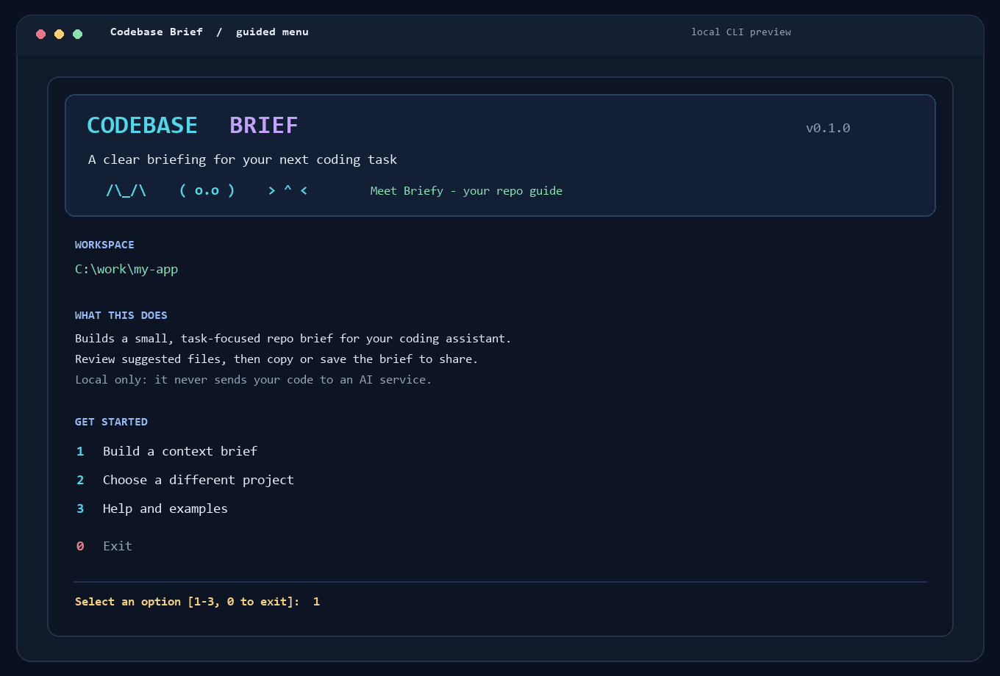
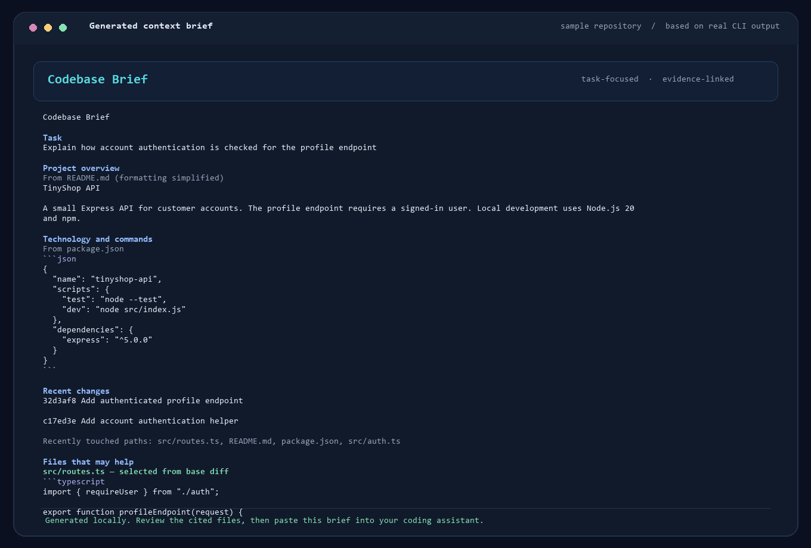

# Codebase Brief

[](https://github.com/mohamed1111111m/codebase-brief/actions/workflows/test.yml)
[](https://www.python.org/)
[](LICENSE)

**Give a coding assistant a clear map of a repository before it starts a task.** Codebase Brief reads a local project and creates a compact Markdown brief with relevant files, recent Git changes, and source paths you can check.

It works locally, without an AI service or account. You choose what to do with the brief: review it, save it, or paste it into Claude Code, Cursor, OpenCode, Codex, or another coding assistant.

## See it in action

The guided screen below is the app's numbered menu. The sample brief was generated by running Codebase Brief on a small example repository with a Git base ref.





## Get started

You need Python 3.10 or newer. Git is optional, but it enables recent-history and base-diff details.

Install the project from GitHub in a virtual environment, then launch the menu:

```powershell
python -m venv .venv
.venv\Scripts\Activate.ps1
python -m pip install git+https://github.com/mohamed1111111m/codebase-brief.git
brief
```

On macOS or Linux, activate the environment with `source .venv/bin/activate` after creating it with `python3 -m venv .venv`.

If the `brief` command is not available, use `python -m context_inject` while that same virtual environment is active.

## Use the menu

When the menu opens, it uses the folder you launched it from as the starting project. Type a number and press Enter:

1. **Build a context brief** — describe the coding task, optionally enter a Git base ref, then accept or change the approximate size limit.
2. **Choose a different project** — point the tool at another local repository or source folder.
3. **Help and examples** — see the workflow and an example command.
0. **Exit** — close the menu.

Before generating the brief, the tool shows suggested files and why they were selected. Press Enter to keep the checked files, type file numbers to toggle selections, or type `none` for an overview without source excerpts. Then choose whether to show the result, save it, choose another output path, or copy it to your clipboard.

For your first try, choose a project you know and a task you understand. Check whether the suggested files are the ones you would have shown a coding assistant yourself.

## Run it with a command

You can skip the menu and generate a brief directly:

```powershell
brief "C:\work\my-app" --task "Add authentication middleware" --base main --budget 2400 --output context.md
```

Replace the example folder and task with your own. `--base main` prioritizes files changed between `main` and the current `HEAD`; omit it if you do not want a Git diff. `--output context.md` saves the result to that path. Without `--output`, the brief is printed in the terminal.

To copy the result directly to your clipboard, use `--copy` instead of `--output`:

```powershell
brief "C:\work\my-app" --task "Find the login flow" --copy
```

The generated Markdown is a starting map for your assistant, not a complete copy or analysis of the repository. Review it, then paste it into the coding assistant where you want to work.

## What it includes

- Project documentation and common stack manifests, such as `package.json` and `pyproject.toml`.
- Recent Git commit subjects and changed paths when Git is available.
- A short list of task-related files with a note explaining each suggestion.
- Small excerpts from selected files, within the requested size budget.
- Source paths throughout the brief so you can open and verify the material.

The file picker uses task words, recent changes, selected Git diffs, common entry points, and direct local Python or JavaScript/TypeScript imports. These are simple heuristics, not semantic code analysis. It traces at most one direct import hop for supported languages, so it can miss relevant files.

## Privacy and limitations

- Repository reading and brief generation happen on your computer. The application has no AI calls, telemetry, or hosted service.
- The tool does not write inside the target repository unless you choose an output path there. The menu's default save location is `context.md` in the current working folder.
- Common credential files, ignored files, generated files, and private-key files are excluded. Some recognizable secret formats and assignments are redacted.
- Filtering is best-effort, not a security guarantee or full secret scan. Review the brief before sharing it, especially when working with private code.
- The size budget is approximate: it estimates tokens from character count and is not tied to a particular model tokenizer.
- Without Git, the tool still reads supported documentation and manifests, but cannot include Git history or diff details.

## Development

Clone the repository, create a virtual environment, and install the project in editable mode:

```powershell
python -m venv .venv
.venv\Scripts\Activate.ps1
python -m pip install --editable .
python -m unittest discover -s tests -v
```

See [CONTRIBUTING.md](CONTRIBUTING.md) for contribution notes, [CHANGELOG.md](CHANGELOG.md) for project changes, and [LICENSE](LICENSE) for the MIT terms.